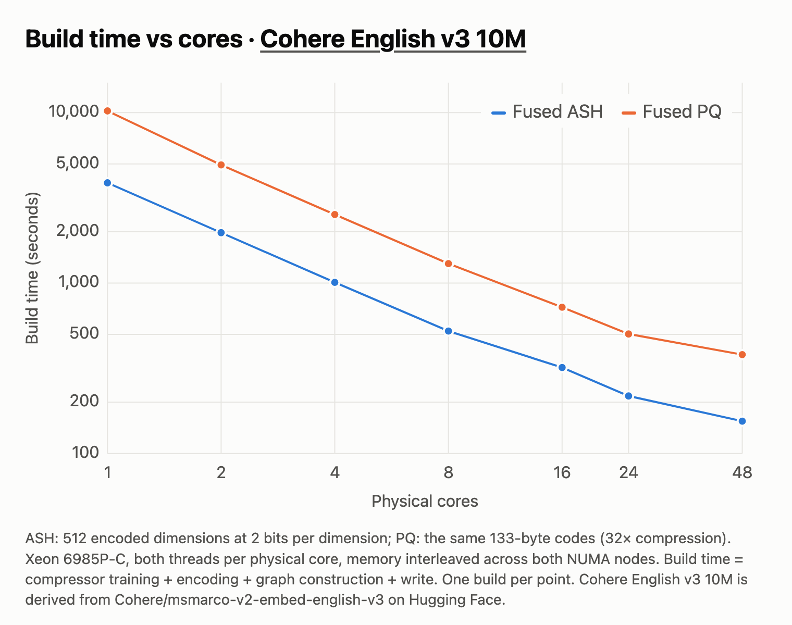
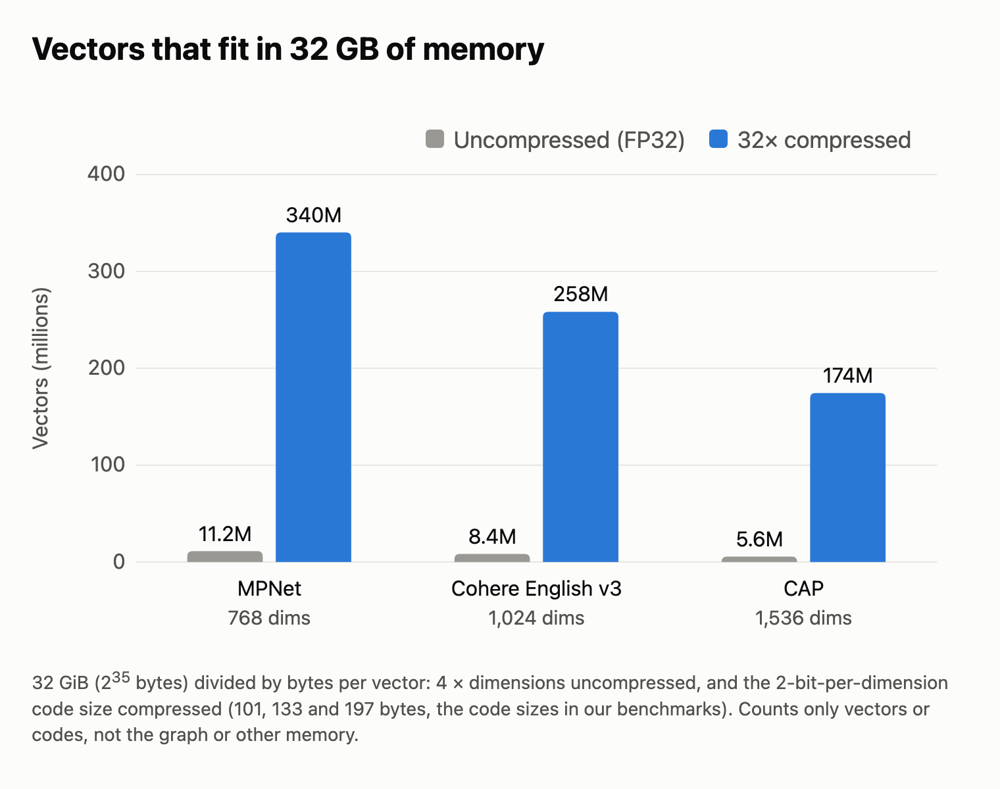
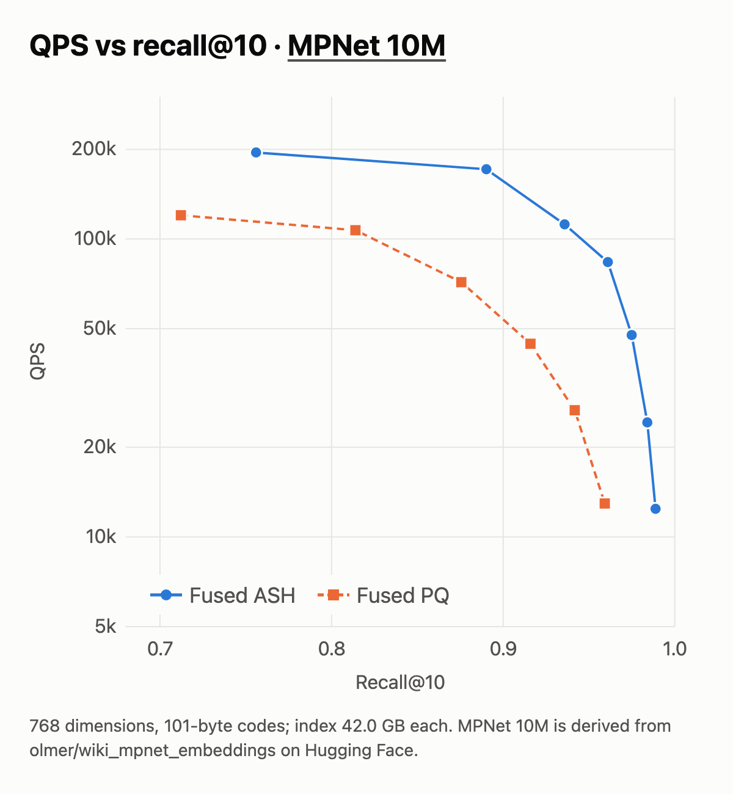
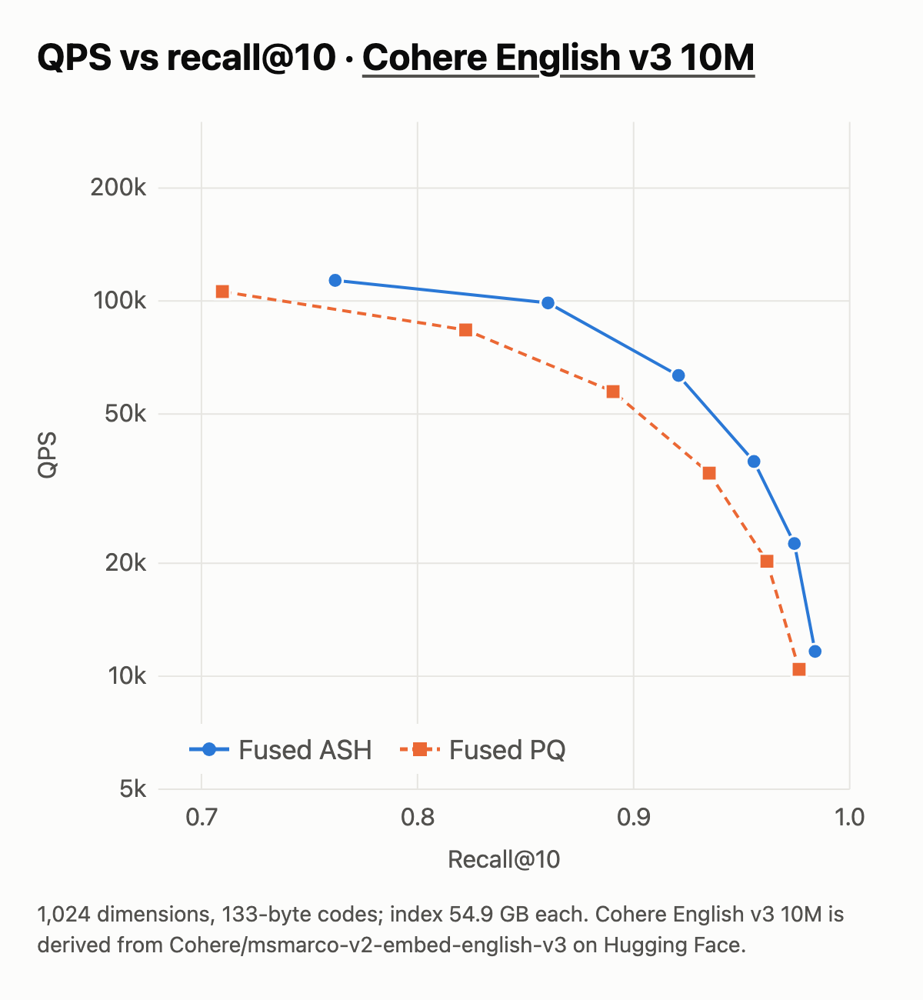
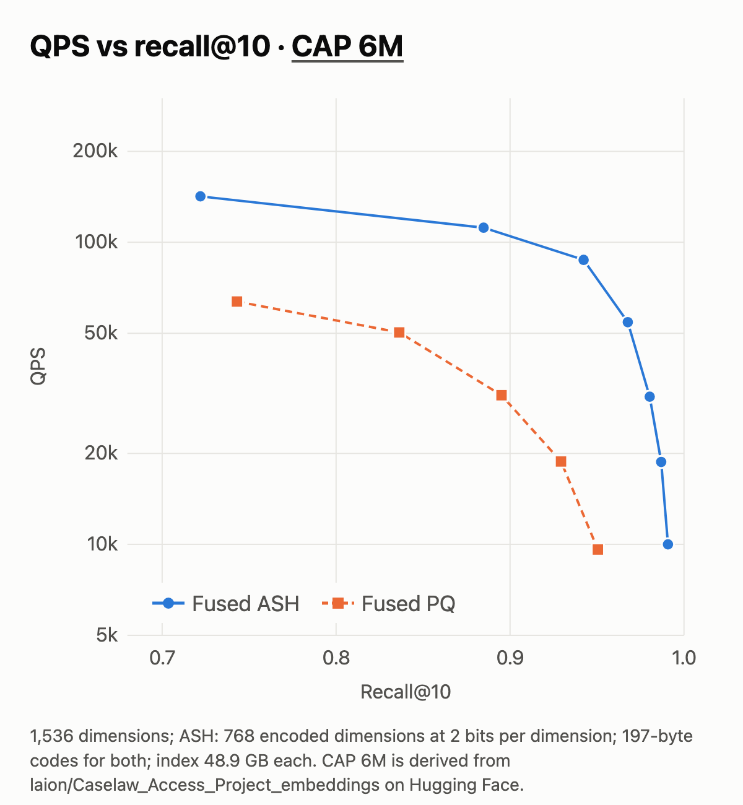

# JVector

JVector is a Java library for approximate nearest neighbor (ANN) vector search. It builds graph
indexes that combine an HNSW-style hierarchy with Vamana (the algorithm behind DiskANN) in every
layer, can be built concurrently and incrementally, and can be searched from disk with compressed
vectors. [Product quantization (PQ)](https://doi.org/10.1109/TPAMI.2010.57) is the stable, widely deployed way to compress them. The
experimental [Asymmetric Scalar Hashing (ASH)](https://dl.acm.org/doi/10.1145/3799682.3841072) quantizer is more accurate at the same code size and
builds indexes faster. JVector targets newer JVMs, using native SIMD kernels on Java 22 and later,
and also supports Java 11.

Full documentation is at [datastax.github.io/jvector](https://datastax.github.io/jvector/).

- [Why graph indexes](#why-graph-indexes)
- [How JVector searches](#how-jvector-searches)
- [Getting started](#getting-started)
- [Choosing a quantizer](#choosing-a-quantizer)
- [Benchmarking with BenchYAML](#benchmarking-with-benchyaml)
- [SIMD and native acceleration](#simd-and-native-acceleration)
- [Research](#research)
- [Building and testing](#building-and-testing)

## Why graph indexes

Exact nearest neighbor search is prohibitively expensive at high dimension: methods that partition
space well in two or three dimensions, such as k-d trees, degrade to linear scans as dimension
grows ("[the curse of dimensionality](https://en.wikipedia.org/wiki/Curse_of_dimensionality)"). For
large datasets, an approximate answer in logarithmic time is usually more useful than an exact
answer in linear time.

[ANN indexes](https://www.ibm.com/think/topics/vector-search) are either partition-based, like
[LSH](https://en.wikipedia.org/wiki/Locality-sensitive_hashing) or [IVF](https://doi.org/10.1109/TPAMI.2010.57)
and [ScaNN](https://github.com/google-research/google-research/tree/master/scann), or graph-based,
like [HNSW](https://arxiv.org/abs/1603.09320) and
[DiskANN](https://www.microsoft.com/en-us/research/project/project-akupara-approximate-nearest-neighbor-search-for-large-scale-semantic-search/).
Graph indexes tend to be faster and, more importantly, can be built and updated incrementally, which
makes them a better fit for a general-purpose index than partitioning schemes that need the whole
dataset up front.

## How JVector searches

JVector's graph has an in-memory hierarchy of upper layers for fast navigation and a base layer that
can live on disk. Construction uses nonblocking concurrency control, so it scales with cores.

Graph indexes need their vectors close at hand, and full-precision vectors soon outgrow memory:
10 million 1,024-dimension vectors take about 41 GB. JVector compresses them with vector
quantization, here 32× to about 1.3 GB, and the quantizer also sets much of the build time. On that
dataset, Cohere English v3 10M, JVector's new ASH quantizer builds the index 2.3 to 2.6 times faster
than product quantization (PQ) with the same code size; see [Choosing a quantizer](#choosing-a-quantizer).



Searches run in two passes. The first pass traverses the graph using compact, approximate scores
from a quantizer; the second reranks the best candidates with a more accurate representation stored
in the index:

| Pass | Options |
| --- | --- |
| Traversal | Product quantization (PQ), optionally with anisotropic weighting; binary quantization (BQ); Asymmetric Scalar Hashing (ASH, experimental); or full-precision vectors |
| Fused traversal | Fused PQ or fused ASH: each node's adjacency list carries its neighbors' codes, so the codes are read with the graph instead of held in memory |
| Reranking | Full-precision (FP32) vectors or [NVQ](https://arxiv.org/abs/2509.18471), a high-accuracy non-uniform quantization |

The compact codes only steer the traversal; the final ranking comes from the more accurate vectors,
so [this two-pass design cuts memory use and latency while preserving accuracy](https://thenewstack.io/why-vector-size-matters/).
JVector builds indexes the same way, so both building and serving need only the codes in memory,
and one index can hold far more vectors than would fit uncompressed:



## Getting started

### Prerequisites

- **JDK 22 or newer** to build. The library itself runs on Java 11 and newer.
- **Maven 3.8 or newer** and **Git**.
- **Linux x86-64 or AArch64** for the native library, which needs GCC 12 or newer (11 or newer on
  AArch64), [Meson](https://mesonbuild.com/) and [Ninja](https://ninja-build.org/); the
  `-Dnative.onednn=true` option below also needs CMake 3.13 or newer. On Ubuntu,
  `bash build_native_lib.sh --auto-install-deps` (in `jvector-native/src/main/native/src`) installs them.
- **macOS and other platforms** build without the native library and use the Panama Vector API on
  Java 20 and newer. Everything below runs there except HelloASHWorldInt8 and HelloASHWorldFp16.

### Using JVector in your project

JVector is published to Maven Central as `io.github.jbellis:jvector`:

```xml
<dependency>
  <groupId>io.github.jbellis</groupId>
  <artifactId>jvector</artifactId>
  <version>4.1.0-rc.1</version>
</dependency>
```

or with Gradle, `implementation("io.github.jbellis:jvector:4.1.0-rc.1")`. ASH requires 4.1.0-rc.1 or later.
[Building and installing JVector](./docs/building-and-installing.md) explains what the jar contains,
the JVM options for each Java version, and how to build JVector from source for each platform.

Run with these JVM options to enable SIMD acceleration (see
[SIMD and native acceleration](#simd-and-native-acceleration)):

```text
--add-modules jdk.incubator.vector
--enable-native-access=ALL-UNNAMED
```

### Hello world programs

The fastest way in is the hello-world programs in [jvector-examples](./jvector-examples). They download
small public datasets on first use. Build them once from the repository root:

```bash
mvn -pl jvector-examples -am -DskipTests package -Dnative.onednn=true
JAR=$(ls jvector-examples/target/jvector-examples-*-jar-with-dependencies.jar)
```

`-Dnative.onednn=true` builds the oneDNN add-on from source and packages it in the jar; ASH uses it
for FP16 query projection and, on some processors, INT8 (see the
[native build guide](./jvector-native/src/main/native/README.md#recommended-onednn-build-and-package)).
It needs CMake and adds a few minutes to the first build. Without it, the library falls back to
slower ASH query projection on those paths, and HelloASHWorldFp16 cannot run.

| Program | What it shows |
| --- | --- |
| [HelloVectorWorld](./jvector-examples/src/main/java/io/github/jbellis/jvector/example/HelloVectorWorld.java) | Build an in-memory graph and search it, in about twenty lines |
| [HelloASHWorld](./jvector-examples/src/main/java/io/github/jbellis/jvector/example/HelloASHWorld.java) | Train ASH, build a graph, write a fused ASH index with NVQ reranking, reopen it, and search synchronously and through the queued API; runs on any processor, with the fastest query projection it supports |
| [HelloASHWorldInt8](./jvector-examples/src/main/java/io/github/jbellis/jvector/example/HelloASHWorldInt8.java) | The same with INT8 query projection required; needs x86-64 with AVX-512 VNNI or AVX-VNNI |
| [HelloASHWorldFp16](./jvector-examples/src/main/java/io/github/jbellis/jvector/example/HelloASHWorldFp16.java) | The same with FP16 query projection required; needs x86-64 with AVX-512 FP16 (Intel Sapphire Rapids or newer) and the oneDNN add-on |
| [HelloBatchedVectors](./jvector-examples/src/main/java/io/github/jbellis/jvector/example/HelloBatchedVectors.java) and [HelloBatchedQuantization](./jvector-examples/src/main/java/io/github/jbellis/jvector/example/HelloBatchedQuantization.java) | Batched access to file-backed vectors, and encoding them with PQ and NVQ |

```bash
java --add-modules jdk.incubator.vector --enable-native-access=ALL-UNNAMED \
  -cp "$JAR" io.github.jbellis.jvector.example.HelloVectorWorld
```

The first run downloads `ada002-100k` (about 650 MB); then it builds the graph and prints the ten
nearest neighbors of one query, in under a minute on an 8-core machine:

```text
Nearest neighbors to the first query in ada002-100k (99287 indexed vectors)
vector 68115  score 0.980714
vector 48543  score 0.980705
...
```

Run the others the same way, changing the class name. On Linux,
`grep -o -m1 -w 'avx512_fp16\|avx512_vnni\|avx_vnni' /proc/cpuinfo` shows whether your processor
supports HelloASHWorldInt8 or HelloASHWorldFp16. Each ASH program writes its index (`ash.graph`,
`ash-int8.graph` or `ash-fp16.graph`) to the current directory and never overwrites one; delete it
or pass a new path as the argument to run again. The programs and tutorials download about 1.3 GB
of datasets into `dataset_cache/`, and the BenchYAML example below writes a 510 MB index while it
runs; set `DATASET_CACHE_DIR` to keep the downloads elsewhere.

The [examples README](./jvector-examples/README.md) covers each program, and the
[tutorials](./docs/tutorials/) walk through the API step by step, starting with
[the introduction](./docs/tutorials/1-intro-tutorial.md).

Integrators should also read:

- [Batched input vector access](./docs/batched-vector-access.md) for file-backed input datasets.
- [Deferred batch serialization](./docs/deferred-batch-writer.md) for writing completed graphs.
- [UPGRADING.md](./UPGRADING.md) for API and on-disk format changes between releases.

## Choosing a quantizer

A quantizer compresses each vector to a short code. Scoring a query against a code is much cheaper
than against a full vector, and the codes for a large index fit in memory or in a small part of
each disk read. Building a graph is a long series of searches: each new vector searches the graph
for its neighbors. JVector can score these searches with the codes, so a quantizer's training,
encoding and scoring speeds set much of an index's build time.

A *fused* index stores each node's neighbors' codes in that node's on-disk record, next to its
adjacency list. A search then reads the codes it needs along with the graph, instead of holding every
code in memory; see [Building and serving larger-than-memory indexes](./docs/larger-than-memory-indexes.md).

[Product quantization (PQ)](https://doi.org/10.1109/TPAMI.2010.57) splits each vector into
subvectors and replaces each with the nearest entry of a codebook learned for it (see
[the PQ tutorial](./docs/tutorials/3-larger-than-memory-tutorial.md)).
[Asymmetric Scalar Hashing (ASH)](https://dl.acm.org/doi/10.1145/3799682.3841072), new and
experimental, reduces each vector's dimension with a learned projection and quantizes each projected
dimension to a few bits (see [ASH](#ash)). The build-time plot above compares fused ASH and fused PQ
with the same 133-byte codes, from training through writing the index.

| Quantizer | Use it for | Notes |
| --- | --- | --- |
| **PQ** | Graph traversal; the stable default | Fused or in memory; any similarity; optional anisotropic weighting |
| **ASH** (experimental) | Graph traversal, especially at high compression | Most accurate at a given code size; fast training and encoding; fused or in memory; any similarity |
| **BQ** | Very fast, coarse traversal | One bit per dimension |
| **NVQ** | Reranking | Stored in the graph; high accuracy at about a quarter of FP32's size |

### ASH

ASH is experimental: its public types are marked `@Experimental`, and their API may change between
releases. PQ remains the recommended choice when stability matters most.

ASH (Asymmetric Scalar Hashing; [paper](https://dl.acm.org/doi/10.1145/3799682.3841072)) reduces the dimension of database
vectors with a learned orthonormal projection, then scalar-quantizes each projected dimension to a
few bits, while keeping queries in their original form. At the same code size it is more accurate than additive and scalar quantizers,
trains and encodes quickly, and scores with SIMD lookups. JVector is the first graph index to support
it. On large datasets at matched code sizes, fused ASH builds faster than fused PQ, is more
accurate, and searches faster in nearly every case; see [ASH performance](./docs/ash-performance.md).

At the same code size, ASH reaches higher recall at a given throughput on each of these datasets:





<sub>Fused ASH and fused PQ with the same code size (32× compression), on a Google Cloud
n2-standard-64: each index was built once on 32 cores and queried on 32 cores, with the index in
memory and queries it had not seen. Points are rerank depths up to 640, from recall 0.7 up; the
deepest is the mean of three runs. ASH used queued execution and adaptive termination, PQ direct
execution. Each index is one segment with NVQ reranking vectors.</sub>

Start with the HelloASHWorld programs above, then:

- [ASH configuration and defaults](./docs/ash-configuration.md): model parameters, construction
  scoring, precision and JVM settings.
- [Integrating ASH queries into a database](./docs/ash-query-integration.md): concurrency, bounded
  admission and batched query projection.
- [Choosing ASH query-projection precision](./docs/ash-projection-precision.md): FP16, FP32 or INT8
  by processor.
- [Building and serving larger-than-memory indexes](./docs/larger-than-memory-indexes.md): sizing,
  streamed construction, page-aligned records and query settings for indexes served from disk.

An ASH model is trained for one similarity, `DOT_PRODUCT`, `EUCLIDEAN` or `COSINE`, chosen when it is
created and saved with it; every scorer of its codes uses it. ASH does not require normalized vectors. See
[Similarity](./docs/ash-configuration.md#similarity).
Training uses the system BLAS and LAPACK (MKL or OpenBLAS) when installed, with a slower Java
fallback; see [BLAS threads](./docs/ash-configuration.md#blas-threads).

ASH also brings:

- **Streaming construction.** `StreamingASHIndex` builds and searches a graph while vectors arrive,
  holding only the graph and ASH codes. It can start cold, train its first model from a sample, and
  move to newer models without rebuilding the graph or stalling inserts
  ([StreamingBuild](./jvector-examples/src/main/java/io/github/jbellis/jvector/example/StreamingBuild.java)).
- **Native query projection** in FP32, FP16 or INT8, chosen by processor; see
  [Choosing ASH query-projection precision](./docs/ash-projection-precision.md).
- **Queued, batched queries.** `QueryPreparer` and `BatchingExecutor` project many queries at once
  and bound the work admitted, for database integrations; see
  [Integrating ASH queries](./docs/ash-query-integration.md).

### On-disk format version 8

JVector now writes on-disk format version 8 by default, for every index. Version 8 records the index's
similarity function in the header, so a loaded index knows how it was built:
`searcher.search(query, topK, rerankK, Bits.ALL)` searches by that function, and the older
`search(..., similarityFunction, ...)` logs a warning when it is given a different one. Version 7 added
fused ASH, separate ASH codes and page-aligned records, which require version 7 or later. JVector 4.0.x
reads up to version 6 and 4.1.0-rc.1 up to version 7; to keep a rollback possible, write the older
version with `withVersion` until every reader is upgraded. Page-aligned
records (`withPageAlignment`, for any index) keep each node's record from crossing a device page, so
a larger-than-memory index reads one page per node it expands instead of sometimes two; see [Building and serving larger-than-memory indexes](./docs/larger-than-memory-indexes.md).
[UPGRADING.md](./UPGRADING.md) gives the details.

## Benchmarking with BenchYAML

BenchYAML builds and measures indexes from YAML descriptions of datasets, index parameters and
measurements. For a first run, benchmark one small public dataset from the repository root. It downloads
on first use (about 430 MB), then builds and searches 100,000 vectors in about a minute and prints recall and throughput tables:

```bash
mvn compile exec:exec@bench -pl jvector-examples -am -DbenchArgs=cohere-english-v3-100k
```

Without `-DbenchArgs`, the same command runs the default set of small public datasets.

Select datasets by name with `-DbenchArgs="cohere ada002"`, or run one index configuration by path,
such as an [example pipeline](./jvector-examples/yaml-configs/index-parameters/README.md). Compressed
datasets use fused ASH by default.

- [How to run benchmarks](./docs/benchmarking.md): datasets, parameters, and output.
- [BenchYAML Guide](./docs/benchyaml-guide.md): every construction and search field, and every console and CSV result field.
- [Benchmark launcher](./jvector-examples/bench-profiles/README.md): rebuild and run one experiment
  in one JVM from the command line or IntelliJ.
- [Reproducing ASH versus PQ](./docs/ash-pq-benchmark.md): run the ASH and PQ comparison on public datasets.

## SIMD and native acceleration

On Java 22 and later, JVector prefers its native provider, built on
[Google Highway](https://github.com/google/highway), when the native library is available. Native
libraries are bundled for Linux x86-64 (SSE4.2 or newer) and Linux AArch64. Java 20 and 21 use the
Panama Vector API, and older runtimes use a scalar Java implementation.

Highway lets each kernel be written once and compiled for every instruction-set tier; at startup
the library picks the best tier the processor supports. One source gives native performance from
SSE4.2 to AVX-512 with VNNI and FP16 on x86-64, and from NEON to SVE2 on AArch64. A new kernel
is written once for all tiers, with a hand-tuned override only where one tier needs it, and new
processor tiers follow a short documented recipe (see
[adding a kernel](./jvector-native/src/main/native/README.md#adding-a-new-simd-kernel)). Distance
functions, PQ and ASH scoring, and ASH query projection all run on these kernels.

| JVM property | Effect |
| --- | --- |
| None | Prefer native on Java 22+, else Panama, else scalar |
| `-Djvector.enable_native_vectorization=false` | Disable automatic native selection |
| `-Djvector.vectorization_provider=panama` | Select Panama |
| `-Djvector.vectorization_provider=native` | Require native; fail if it cannot load |
| `-Djvector.vectorization_provider=default` | Select the scalar provider |

If native access is denied, automatic selection falls back to Panama. For named-module deployments,
enable native access for the module containing JVector's native code. Native ISA selection is
automatic and can be capped with `JVECTOR_MAX_ISA`. The x86-64 tiers are SSE4.2, AVX2, AVX-512,
AVX-512 with VNNI, AVX-512 with VNNI and VBMI2, and AVX-512 with FP16; the AArch64 tiers are
NEON, SVE and SVE2. See the
[native library README](./jvector-native/src/main/native/README.md) for the values.

The native provider stores vectors as `MemorySegmentVectorFloat`. Use the `VectorFloat` interface
rather than casting to `ArrayVectorFloat`; `FloatArray.array()` gives array access, and native
operations need vectors created by the selected provider.

ASH uses native kernels for query projection (including INT8 on AVX-512 VNNI CPUs) and scoring,
and an optional add-on built on [oneDNN](https://github.com/uxlfoundation/oneDNN) for FP16 query
projection, INT8 on other VNNI CPUs, and batch encoding. Each falls back to a portable implementation when unavailable.

## Research

- Foundations: the [HNSW](https://ieeexplore.ieee.org/abstract/document/8594636) and
  [DiskANN](https://suhasjs.github.io/files/diskann_neurips19.pdf) papers, and
  [a higher-level explainer](https://en.wikipedia.org/wiki/Hierarchical_navigable_small_world)
- [ASH: Asymmetric Scalar Hashing With Learned Dimensionality Reduction for High-Fidelity Vector Quantization](https://dl.acm.org/doi/10.1145/3799682.3841072), Tepper and Willke (CIKM 2026)
- [Product quantization](https://doi.org/10.1109/TPAMI.2010.57), Jégou, Douze and Schmid (TPAMI 2011)
- [NVQ](https://arxiv.org/abs/2509.18471)
- [Anisotropic PQ](https://arxiv.org/abs/1908.10396)
- [Quicker ADC](https://arxiv.org/abs/1812.09162)

## Building and testing

[Building and installing JVector](./docs/building-and-installing.md) covers builds for each platform
and backend; this section summarizes them.

JVector is a [multimodule Maven build](https://maven.apache.org/guides/mini/guide-multiple-modules.html)
that produces a multirelease JAR usable from Java 11:

| Module | Contents |
| --- | --- |
| [jvector-base](./jvector-base) | Core library, compiled for Java 11 |
| [jvector-twenty](./jvector-twenty) | Panama Vector API provider, compiled for Java 20 |
| [jvector-native](./jvector-native) | Native provider and libraries, Java 22 |
| [jvector-multirelease](./jvector-multirelease) | Packages the three modules above as the published `jvector` JAR |
| [jvector-examples](./jvector-examples) | Examples, BenchYAML and benchmarks |
| [jvector-tests](./jvector-tests) | Tests, runnable on Java 11 and newer |

Build with JDK 22 or newer. The native library is built with [Meson](https://mesonbuild.com/) and
[Ninja](https://ninja-build.org/) and needs GCC 12 or newer on x86-64 (11 or newer on AArch64); Meson fetches the pinned Google Highway
source on first build. The optional oneDNN add-on for ASH query projection is a separate Meson
project; it also needs CMake 3.13 or newer and takes a few minutes to build, so Maven builds it only
with `-Dnative.onednn=true` (the `release` profile and CI turn it on). The [native library README](./jvector-native/src/main/native/README.md) covers build
options, ISA dispatch, adding kernels and
[ABI compatibility](./jvector-native/src/main/native/README.md#native-abi-compatibility).
On Ubuntu, `bash build_native_lib.sh --auto-install-deps` (in `jvector-native/src/main/native/src`)
installs the toolchain and builds the library.

Run the tests with:

```bash
mvn test                                       # all modules, with the SIMD providers on JDK 20+
mvn -DskipScalar=false test                    # also run the scalar provider tests
mvn -pl jvector-tests -am -Pjdk11 -DskipSIMD=true \
  -Djvm=/path/to/jdk-11/bin/java test           # scalar tests on a Java 11 runtime
mvn -Dsurefire.failIfNoSpecifiedTests=false -Dtest=TestNeighborArray test   # one class
```

`-Dtest` also accepts methods and patterns, such as `TestNeighborArray#testRetain*`.
`failIfNoSpecifiedTests=false` is needed because Surefire otherwise requires a match in every module.

To release, configure `~/.m2/settings.xml` for OSSRH and run `mvn -Prelease clean deploy`.
